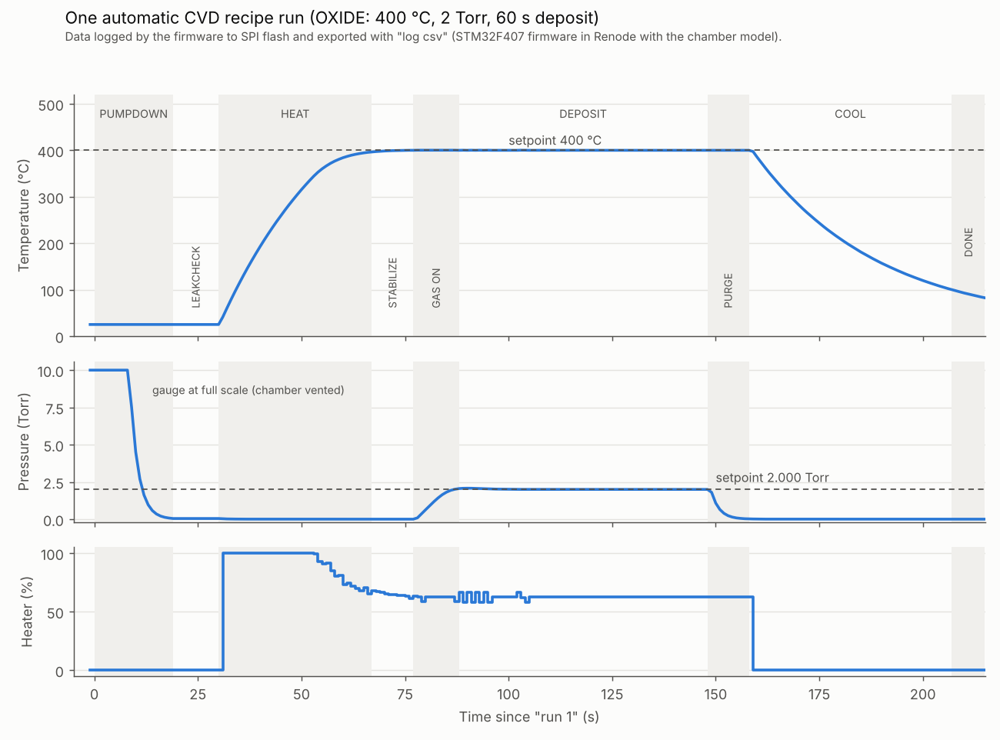
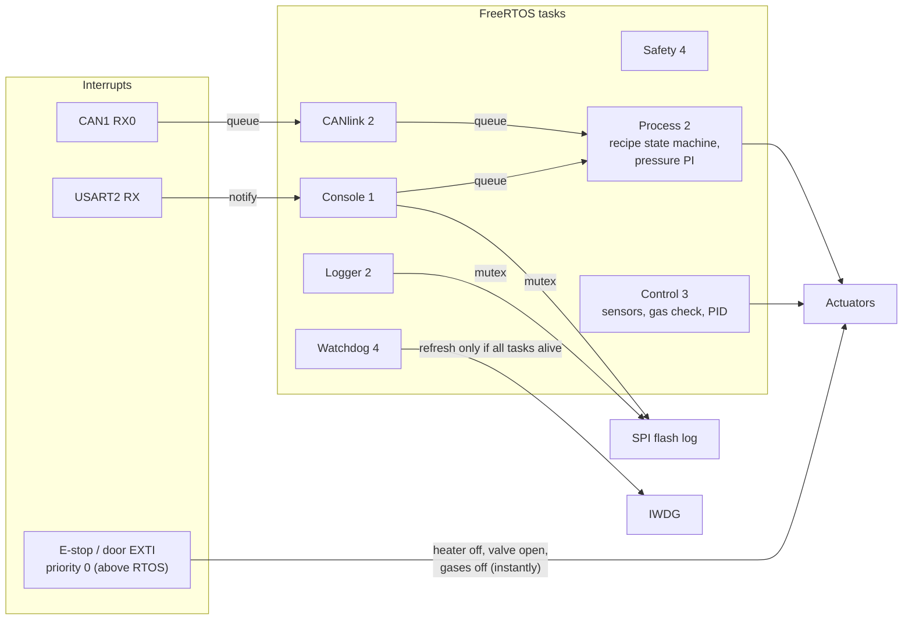

# Semiconductor Process Chamber Controller (CVD)

[](https://github.com/ShruddhaMetri/fab-chamber-controller/actions/workflows/ci.yml)

Firmware for the controller of a **chemical vapour deposition (CVD) chamber**: the tool in a
semiconductor fab that grows thin films (for example silicon dioxide from SiH₄ + N₂O) on wafers.
It runs a complete deposition recipe by itself, under closed-loop temperature and pressure
control, with hardware interlocks, a watchdog, a CAN link to the fab host and a bootloader for
safe field updates.

- **Target:** STM32F407VG (ARM Cortex-M4F, 168 MHz max; run here at 16 MHz HSI)
- **Language:** C11, register-level drivers (no HAL), FreeRTOS V11.1.0
- **Hardware:** none. The firmware runs unchanged in the **Renode** emulator, against Python
  models of the chamber physics (thermal and vacuum), mass-flow controllers, an EEPROM, a SPI
  flash and a CAN fab host.



*Pump-down, leak check, PID heat-up to 400 °C, gas on with pressure control at 2 Torr, 60 s
deposition, purge and cool-down: all decided by the firmware. The data was logged by the firmware
itself to SPI flash and exported with the `log csv` command.*

---

## Features

| Area | What it does | Where |
|---|---|---|
| Drivers | GPIO, USART (interrupt RX + ring buffer), SysTick, EXTI, TIM3 PWM, ADC + DMA scan, DAC, I²C, SPI, bxCAN, IWDG, internal flash - all register level | `Src/*.c` |
| Safety interlocks | E-stop and door on EXTI at the highest interrupt priority (above the RTOS), over-temperature with hysteresis, gas-flow deviation; latched faults, "trip fast, recover deliberately" | `safety.c`, `sensors.c`, `gas.c` |
| Temperature control | Fixed-point PID (gains in thousandths), conditional-integration anti-windup, derivative on measurement, 64-bit intermediates, MANUAL/AUTO lock-out | `temp_ctrl.c` |
| Pressure control | Reverse-acting PI on the throttle valve, tuned offline against the vacuum model | `process.c` |
| Recipe automation | State machine: PUMPDOWN → LEAKCHECK (rate-of-rise) → HEAT → STABILIZE → GAS_ON → DEPOSIT → PURGE → COOL, timeouts and excursion aborts on every step | `process.c` |
| Storage | Recipes in I²C EEPROM (CRC-16, magic, read-after-write verify); append-only process log in SPI NOR flash, background erase | `recipe.c`, `datalog.c` |
| RTOS | 8 FreeRTOS tasks, queues, task notifications, mutexes with priority inheritance, stack and jitter monitoring | `rtos_app.c` |
| Fab host link | CAN 500 kbit/s, hardware acceptance filter, event/status/command protocol, heartbeat supervision | `can.c`, `canlink.c` |
| Reliability | Independent watchdog fed only when all tasks check in, HardFault capture (PC/LR/CFSR), reset cause kept in RTC backup registers, WFI idle | `health.c` |
| Field update | Bootloader + staging sector, image sent over CAN, CRC-32 checked twice, power-fail-safe install | `chamber_boot/`, `fwupdate.c` |
| Tests | 16 host unit tests (PID against a plant model, CRCs, recipe storage with fault injection), sanitizers, CI on every push | `tests/`, `.github/workflows/` |

## Architecture



## Memory map

| Address | Size | Contents |
|---|---|---|
| `0x08000000` | 32 KB | Bootloader (never changed in the field) |
| `0x08008000` | 16 KB | Installed-application record (size, CRC-32) |
| `0x08020000` | 128 KB | Application |
| `0x08040000` | 128 KB | Staging area for a new image |

## CAN protocol (fab host)

| ID | Direction | Content |
|---|---|---|
| `0x080` | chamber → host | Event (fault change, step change, boot), sent at once; lowest ID wins arbitration |
| `0x100` / `0x101` | chamber → host | Status every 500 ms: faults, step, temperature, pressure, heater, valve, flows |
| `0x180` | chamber → host | Command reply |
| `0x181` | chamber → host | Firmware-update reply |
| `0x200` | host → chamber | Command: RUN recipe, ABORT, PING |
| `0x210` | host → chamber | Host heartbeat (link lost after 3 s) |
| `0x220`-`0x223` | host → chamber | Firmware update: BEGIN, DATA (sequence-numbered), END, INSTALL |

## Verified behaviour (in Renode)

- PID: 400 °C from 25 °C with about 0.2 °C overshoot; P-only leaves the expected 29 °C offset
- Control task period 100 ms with zero late cycles, even while the console is kept busy for 3 s
- Interlocks: e-stop, door, over-temperature and gas-flow faults stop the recipe and the PID; no automatic restart
- Leak check rejects a leaking chamber; deposition aborts on a sustained pressure excursion
- Watchdog: a hung task is detected, the chamber made safe, the chip reset, and the cause reported at boot
- Firmware update v0.14 → v0.15 over CAN; a corrupted transfer is rejected; a corrupted installed image is refused by the bootloader

## Build and run

**Day to day:** STM32CubeIDE projects `firmware/chamber_ctrl` (application) and
`firmware/chamber_boot` (bootloader).

**Command line** (what CI does):

```bash
make -C tests            # unit tests on the PC (gcc)
make -C firmware         # both firmware images (arm-none-eabi-gcc)
```

**Simulation:** in the Renode monitor

```
include @C:/embedded/fab-chamber-controller/renode/chamber.resc
```

then type `help` in the usart2 window. Useful commands: `status`, `temp 400`, `pid`,
`recipe save 1 OXIDE 400 2000 50 400 60`, `run 1`, `proc`, `tasks`, `can`, `diag`, `fw`, `log csv`.
Fab-host commands in the monitor: `fabhost`, `fabrun 1`, `fababort`, `fabevents`, `fabupdate "<path to .bin>"`.

## Repository layout

```
firmware/chamber_ctrl/   application (CubeIDE project): Inc/, Src/, Src/freertos/
firmware/chamber_boot/   bootloader (CubeIDE project)
firmware/Makefile        command-line build of both
renode/                  platform script and Python models (chamber, MFC/DAC, fab host)
tests/                   host unit tests and fakes
docs/                    figures
.github/workflows/       CI
```

## Development history

The project was built in steps, one commit each: tools and blinky, UART console, SysTick
scheduler, ring buffer and command parser, EXTI interlocks, PWM actuators, ADC + DMA sensors,
DAC gas control, I²C EEPROM and SPI flash, PID, FreeRTOS, recipe state machine, CAN, watchdog
and fault capture, bootloader, tests and CI.
